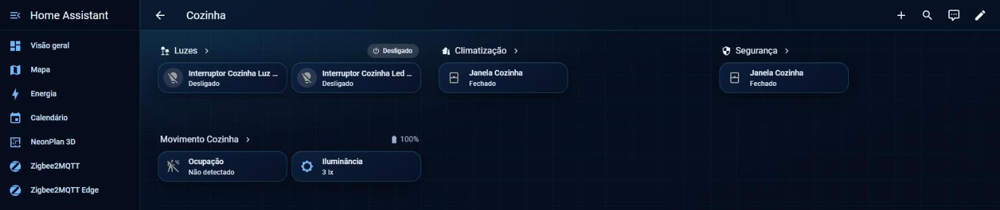
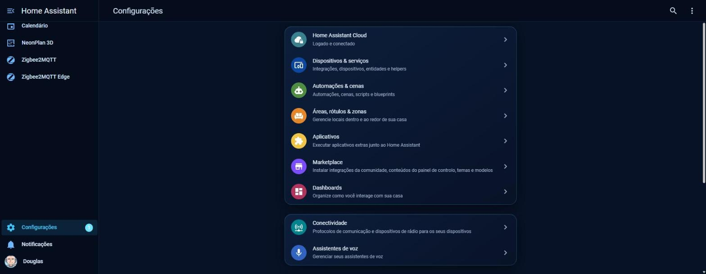

# Doug Futurista — tema para Home Assistant

Tema escuro em **vidro azul-marinho** para o Home Assistant: cartões translúcidos com borda ciano,
menu lateral e barra do topo combinando, e um fundo com grade de circuito feito só com CSS
(nenhuma imagem para baixar). Vale para os painéis, as páginas de área, as configurações e os diálogos.

Feito pelo canal **[Doug Smart Home](https://www.youtube.com/@dougsmarthome)**.





## Instalação

### Pelo Marketplace (recomendado)

1. No Home Assistant, abra **Configurações → Marketplace**.
2. Toque nos três pontinhos → **Repositórios personalizados** e adicione
   `https://github.com/dougbaptista/ha_tema_futurista` com o tipo **Tema**.
3. Procure **Doug Futurista** e instale.
4. Rode a ação `frontend.reload_themes` (ou reinicie o Home Assistant).

### Manual

1. Copie `themes/doug-futurista.yaml` para a pasta `themes/` da sua configuração.
2. Garanta que o `configuration.yaml` carrega os temas:

   ```yaml
   frontend:
     themes: !include_dir_merge_named themes
   ```

3. Reinicie o Home Assistant (ou rode `frontend.reload_themes`).

## Como usar

- **Só para você:** clique no seu nome (canto de baixo do menu) → **Tema** → **Doug Futurista**.
- **Para a casa toda:** rode a ação abaixo em **Ferramentas → Ações**. Quem estiver com "Padrão do servidor" passa a ver o tema.

  ```yaml
  action: frontend.set_theme
  data:
    name: Doug Futurista
  ```

  Repita com `mode: dark` para valer também no modo escuro.

## Vidro de verdade (opcional)

O desfoque atrás dos cartões e da barra do topo usa o **[card-mod](https://github.com/thomasloven/lovelace-card-mod)**.
Instale pelo Marketplace e o efeito aparece sozinho. Sem o card-mod, o tema funciona igual, só sem o desfoque.

## Mudar a cor de destaque

Quer na cor do seu time? No arquivo `doug-futurista.yaml`, troque os dois valores marcados com `DESTAQUE`
(`primary-color` e `accent-color`) e rode `frontend.reload_themes`.

## Cartões (button-card)

Além do tema, o repositório traz os **cartões do vídeo** em [`cards/`](cards):

| arquivo | o que é |
|---|---|
| [`doug-futurista-cards.yaml`](cards/doug-futurista-cards.yaml) | 9 modelos do button-card: `fx_pill`, `fx_pessoa`, `fx_cotacao`, `fx_aspirador`, `fx_ambiente`, `fx_luz`, `fx_sensor`, `fx_acesso`, `fx_pilula` (as variáveis de cada um estão no topo do arquivo) |
| [`exemplo-home.yaml`](cards/exemplo-home.yaml) | uma Home completa usando os modelos: faixa com hora, pílulas, pessoas, aspirador, cotações, luzes, segurança e ambientes, em grade que se adapta ao celular |

Precisa de **button-card** e **layout-card** (os dois no Marketplace); o **card-mod** é opcional.

1. Painel → editar → ⋮ → **Editor de configuração bruta**.
2. No topo, cole `button_card_templates:` e, embaixo (com 2 espaços), o conteúdo de `doug-futurista-cards.yaml`.
3. Dentro de `views:`, cole a view de `exemplo-home.yaml`.
4. Troque os `entity_id` de exemplo (`person.voce`, `light.sala_teto`, ...) pelos da sua casa.
   Entidade que não existir aparece como "entidade não encontrada", em vez de quebrar o cartão.

---

## English

**Doug Futurista** is a dark navy glass theme for Home Assistant: translucent cards with a cyan border,
matching sidebar and header, and a CSS-only circuit-grid background (no image to download).
Install it through **Settings → Marketplace** (custom repository, type *Theme*) or copy
`themes/doug-futurista.yaml` into your `themes/` folder. Optional: install **card-mod** for the frosted-glass blur.
Change the accent color by editing the two `DESTAQUE` values.

## Licença

MIT.
